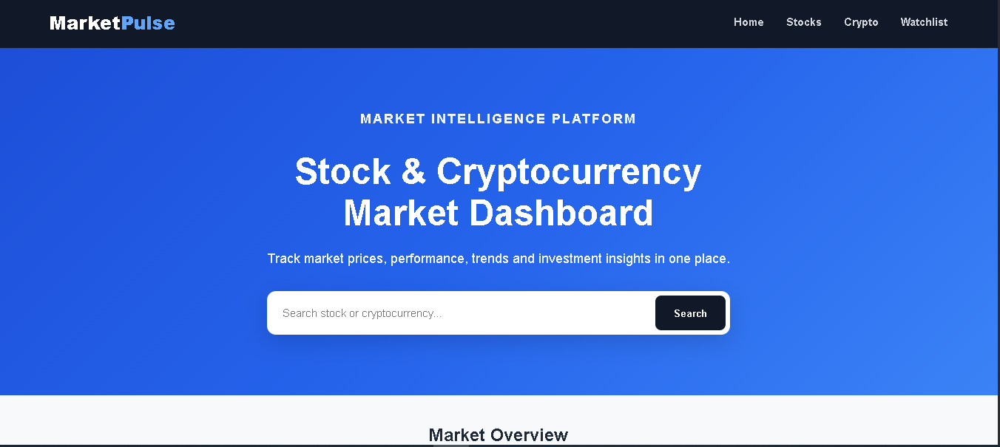

# 📈 MarketPulse – Stock & Cryptocurrency Market Analysis Dashboard

## 📌 About the Project

MarketPulse is a web-based financial market analysis dashboard designed to monitor stock and cryptocurrency market information in one place.

The project combines Python, Flask, HTML, CSS, and JavaScript to provide market information through an interactive and user-friendly interface.

It helps users explore cryptocurrency prices, stock market information, market movements, performance, and watchlist information.

## 🎯 Project Objectives

- Monitor cryptocurrency market information.
- Explore stock market data.
- Analyze market movements and performance.
- Display financial information through interactive dashboards.
- Provide a watchlist for tracking selected assets.
- Build a responsive financial market dashboard.

## 🛠️ Technologies Used

| Technology | Purpose |
|---|---|
| Python | Backend development |
| Flask | Backend framework |
| HTML5 | Web page structure |
| CSS3 | Styling and responsive design |
| JavaScript | Frontend functionality |
| REST APIs | Fetching market information |
| yfinance | Stock market data access |
| CoinGecko API | Cryptocurrency market data |
| Git & GitHub | Version control and project hosting |

## ✨ Key Features

- **Dashboard:** Centralized market information.
- **Cryptocurrency Market:** Explore cryptocurrency market data.
- **Stock Market:** View stock market information.
- **Market Movers:** Explore market movements.
- **Market Overview:** View market information in one place.
- **Market Performance:** Explore market performance.
- **My Watchlist:** Track selected market assets.
- **Flask Backend:** Connect frontend functionality with backend services.

## 📸 Project Screenshots

### 1. Main Dashboard



### 2. Cryptocurrency Market


### 3. Stock Market


### 4. Market Overview


### 5. Market Movers


### 6. Market Performance


### 7. My Watchlist


## 📁 Project Structure

```text
MarketPulse/
│
├── backend/
│   ├── app.py
│   └── requirements.txt
│
├── database/
│
├── frontend/
│   ├── css/
│   │   └── style.css
│   │
│   ├── js/
│   │   └── app.js
│   │
│   └── index.html
│
├── Screenshots/
│   ├── Cryptocurrency Market.png
│   ├── Dashboard.png
│   ├── Market Movers.png
│   ├── Market Overview.png
│   ├── Market Performance.png
│   ├── My Watchlist.png
│   └── Stock Market.png
│
├── .gitignore
└── README.md
```

## ⚙️ Installation and Setup

### Step 1: Clone the Repository

```bash
git clone https://github.com/Tejash10/MarketPulse.git
```

### Step 2: Navigate to the Project Folder

```bash
cd MarketPulse
```

### Step 3: Create a Virtual Environment

```bash
python -m venv venv
```

### Step 4: Activate Virtual Environment

**Windows:**

```bash
venv\Scripts\activate
```

### Step 5: Install Dependencies

```bash
pip install -r backend/requirements.txt
```

### Step 6: Run the Flask Application

```bash
cd backend
python app.py
```

### Step 7: Open in Browser

Open the local URL displayed in your terminal. For example:

```text
http://127.0.0.1:5000
```

## 📚 Learning Outcomes

- Practical experience with Python and Flask.
- Frontend and backend integration.
- Working with financial market APIs.
- Understanding stock and cryptocurrency data.
- Building interactive web dashboards.
- Using Git and GitHub for project management.

## 🔮 Future Improvements

- Add advanced stock and cryptocurrency analytics.
- Implement machine learning-based price prediction.
- Improve portfolio tracking.
- Add more interactive charts and visualizations.
- Enhance real-time market monitoring.

## 👨‍💻 Author

**Tejash**

Computer Science Engineering Graduate

**Interests:** Data Analytics | Python | SQL | Power BI | Machine Learning | Financial Data Analysis

## 🔗 GitHub Repository

[View MarketPulse on GitHub](https://github.com/Tejash10/MarketPulse)

---

⭐ If you find this project useful, consider giving the repository a star!
